# Vespa feed-client shutdown: failure modes and changes

This document accompanies the Java feed-client shutdown contribution. It describes the code in this PR, based on upstream `37ffa51ddd1`, including the review fixes below. The affected code is `HttpFeedClient`, `HttpRequestStrategy`, the new `ShutdownLifecycle`, and the public `ShutdownHandle` API.

The client now tracks accepted operations from request construction through public result publication. Callers share one shutdown outcome, can escalate a graceful close to abort, and can observe completion without owning cleanup. The table below covers the changed paths and new API controls. Some handoff races and resource-release issues remain open; they are listed at the end.

## Why the PR is needed

A request can belong to the client before it has a strategy slot. It can also remain unfinished after its transport response arrives. Closing based only on strategy counters misses those intervals. Separately, starting cleanup is different from finishing it: concurrent callers need the same retained outcome, and a throwing transport must not skip the remaining worker cleanup.

## Design decisions

| Choice | Why | Tradeoff |
| --- | --- | --- |
| One monitor for admission and lifecycle transitions | Admission and shutdown agree on which work the client owns | Adds bookkeeping and synchronization; impact measurements are pending |
| Track operations separately from strategy slots | Construction, result mapping and cancelled public results remain accounted for | Operations remain retained until their internal work resolves |
| Reuse existing retry, throttling and per-document sequencing | Keep this change focused on ownership and shutdown | Existing policy and handoff limitations still need integration testing |
| One cleanup worker and shared outcome | Repeated callers do not start cleanup twice or lose its failure | Startup failure is retained as FAILED; no inline blocking fallback |
| A read-only shutdown handle | Waiting, timing out or being interrupted does not cancel shared shutdown | Existing callback code that blocks in close must use closeAsync and wait elsewhere |
| Identify known progress threads | Prevent a thread from waiting for shutdown that needs that thread | This does not detect arbitrary user dependency cycles |
| Attempt remaining cleanup and retain failures | One transport failure must not skip executor shutdown | FAILED records an unsuccessful cleanup, not complete resource release |

## What the latest checks mean for this PR

| Finding | Implication for callers and reviewers |
| --- | --- |
| Startup can fail while an earlier send is still constructing | FAILED may retain admitted work and resources. It reports an error; it does not report a drained client. |
| An executor can terminate after a wait has timed out | Keep the original failed outcome for concurrent and late callers. Later termination does not turn that outcome into success. |
| Cancellation can complete a public future before mapping resolves | Remove an operation only after registration, internal resolution and public completion. Keep eligible retained entries discoverable by the publication scan. |
| The admission and mapping waits protect different stages | The admission wait orders strategy drainage after construction. The operation wait orders graceful destruction after mapping. Removing the first wait alone does not establish premature destruction if the later wait still blocks. |

These checks support the current changes and clarify their limits; they did not identify another implementation change within these four fixes. The PR remains a draft for the open handoff, resource-release, integration and impact checks below.

## Reading the examples and tests

Snippets are shortened Java excerpts or API examples. Comments omit surrounding code; they are not standalone programs. Each case links to the test source and names the relevant methods. Latches and controlled dependencies force the important ordering. Timeouts bound waits and detect hangs; timing-sensitive checks still need reruns on the maintainer’s environment.

After the review fixes and retired-transport ownership change, a clean affected API/client/CLI reactor passed all 76 tests on JDK 17, including the normal install-phase ABI and packaging checks. The archive timestamp was set explicitly to a valid reproducible value. The test refactor uses JUnit parameterization for both progress-thread contexts, bounded future completion for callback assertions and shared latch/clock fixtures. The public API additions are recorded in the ABI specification.

The generated lifecycle test uses 64 fixed seeds with 100 commands each and prints the history on failure. Earlier mutation checks caught dropped internal-resolution ownership and abort reverting to graceful drain. These are component results; full Vespa integration and impact measurements remain outstanding.

Four new regression cases first failed against the old behavior: worker creation failure, worker start failure, false success after executor timeout, and backlog traversal. After repair they passed. Separate mutations removing the admission and mapping waits were both caught by the strengthened ordering tests. The final clean build restored all production guards and passed with zero failures or skips.

## Failure-mode table

Additional controlled JDK runs recorded 52 observations: thirteen scenarios on JDK 21 and JDK 26, each in mixed and interpreted mode. Three scenarios distinguish timeout with a held worker, interruption with the flag restored, and successful termination. All observations matched their expected endpoints. These runs support the JDK wait contract; they do not replace the 76 Java component tests or real transport validation. Run identifiers, parameters, runtime versions, logs and rendered plots are retained in the separate evaluated notebooks.

Idle reset now uses the same retirement condition as response completion. Two regression cases first observed zero closes instead of one. The expanded controls cover fresh and previously used idle delegates, same-instance replacement, creation failure, throwing retirement and active requests. The source experiment compares unchanged before/after inputs using real file channels and the same release checks; the new ownership comparison checks late response cleanup separately. Shutdown now closes retired delegates even when responses never arrive, and late callbacks only finish accounting.

The late-response regression was first reproduced on the idle-retirement baseline. Expanded baseline checks exposed eight failures. The changed version covers completion during close, no response, repeated completion, blocked retirement and combined close failures. Additional exact-source checks cover three active generations and attempts to reset or dispatch after close.

The new before/after source run recorded 24 expected observations on JDK 21/26 in mixed/interpreted modes. Late old channels open changed from 4/4 to 0/4; idle and active controls stayed closed. Four additional changed-version ownership runs passed, while all four baseline runs reproduced retained resources. These controlled file-channel checks do not establish real HTTP transport behavior or production failure rates.

| Case | Failure mode | Status |
| --- | --- | --- |
| [V01](#v01) | Close overtakes admitted request construction | Changed in this branch |
| [V02](#v02) | Abort reports completion while construction is held | Changed in this branch |
| [V03](#v03) | Response mapping outlives graceful drain | Changed in this branch |
| [V04](#v04) | Cancelling the public result hides transport work | Changed in this branch |
| [V05](#v05) | A construction exception strands admission | Changed in this branch |
| [V06](#v06) | Abort cannot interrupt a graceful drain | Changed in this branch |
| [V07](#v07) | A progress thread waits for its own shutdown | Changed in this branch |
| [V08](#v08) | A second destroy returns before cleanup finishes | Changed in this branch |
| [V09](#v09) | A cleanup failure disappears for later callers | Changed in this branch |
| [V10](#v10) | Transport close skips worker cleanup when it throws | Changed in this branch |
| [V11](#v11) | Cleanup waits while holding the accounting monitor | Changed; focused regression pending |
| [V12](#v12) | Success is reported before dispatcher exit | Changed in this branch |
| [V13](#v13) | A capacity waiter resumes after abort | Changed; handoff races remain open |
| [V14](#v14) | The dispatch loop sends queued work after abort | Changed in this branch |
| [V15](#v15) | An observer interferes with shared shutdown | New API contract and controls |
| [V16](#v16) | A snapshot reports contradictory state | New API validation |
| [V17](#v17) | Worker startup failure strands shutdown | Fixed; cleanup may remain incomplete |
| [V18](#v18) | Executor timeout is mistaken for success | Fixed; timeout reports FAILED |
| [V19](#v19) | Every completion scans the whole backlog | Fixed; impact measurements pending |
| [V20](#v20) | A test checks before cleanup has run | Test ordering corrected |
| [V21](#v21) | Idle reset abandons the old delegate | Fixed for successful idle retirement |
| [V22](#v22) | Late responses lose retired transport cleanup | Fixed with shutdown ownership |

<a id="v01"></a>

## V01: Close overtakes admitted request construction

A send can pass the open check and pause while constructing its request. Graceful close could drain an empty strategy and destroy it before that send registers.

Admit under the lifecycle monitor before construction. Graceful shutdown waits for admitted construction before draining the strategy. The test observes the cleanup worker waiting in awaitAdmissions before checking that destruction has not started.

```java
ShutdownLifecycle.Operation operation = lifecycle.admit();
try {
    // Construct and enqueue the request.
} finally {
    lifecycle.registered(operation);
}
```

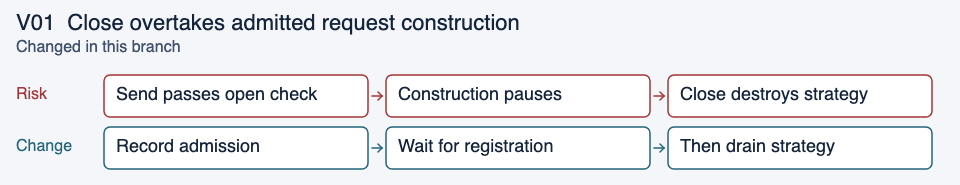

Evidence: [HttpFeedClientShutdownTest](../../vespa-feed-client/src/test/java/ai/vespa/feed/client/impl/HttpFeedClientShutdownTest.java): `gracefulCloseWaitsForAdmittedConstruction`.

<a id="v02"></a>

## V02: Abort reports completion while construction is held

Abort should start cleanup promptly, but held request construction still belongs to the client. Reporting successful termination at that point loses track of it.

Start abort cleanup without waiting for construction, then wait for outstanding operations before publishing successful termination. A failed cleanup remains FAILED, not a claim of release.

```java
requestStrategy.destroy();
if (failure == null)
    lifecycle.awaitOperations(() -> true);
lifecycle.finish(failure);
```

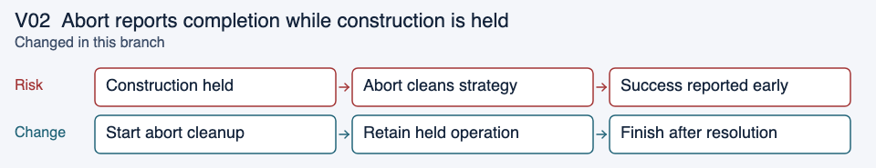

Evidence: [HttpFeedClientShutdownTest](../../vespa-feed-client/src/test/java/ai/vespa/feed/client/impl/HttpFeedClientShutdownTest.java): `abortDoesNotCertifyTerminationWhileConstructionIsOwned`.

<a id="v03"></a>

## V03: Response mapping outlives graceful drain

The transport response can be ready while conversion to the public Result is still blocked. Strategy counters alone do not cover that work.

Retain the operation through internal resolution and public result publication. This does not promise to wait for arbitrary user continuations on caller-owned threads. The test observes the cleanup worker in awaitOperations while result mapping is held.

```java
if (operation.registered && operation.resolved && operation.result.isDone())
    operations.remove(operation);
```

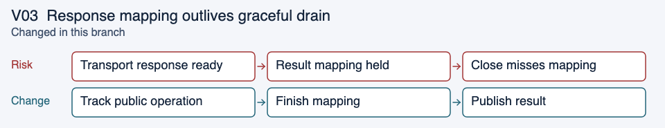

Evidence: [HttpFeedClientShutdownTest](../../vespa-feed-client/src/test/java/ai/vespa/feed/client/impl/HttpFeedClientShutdownTest.java): `responseMappingRemainsOwnedUntilPublicResultIsPublished`.

<a id="v04"></a>

## V04: Cancelling the public result hides transport work

A caller can cancel its result before the underlying transport operation resolves. Using only isDone would remove that operation too early.

Require internal resolution as well as public completion before dropping ownership. Cancellation of the public future does not itself stop the transport.

```java
result.cancel(false);
// Ownership remains until internal resolution.
```

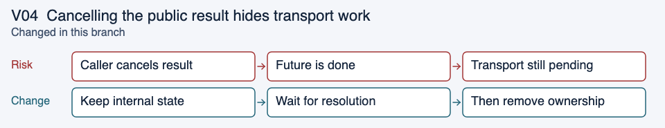

Evidence: [HttpFeedClientShutdownTest](../../vespa-feed-client/src/test/java/ai/vespa/feed/client/impl/HttpFeedClientShutdownTest.java): `cancelledPublicResultDoesNotDischargeTransportOwnership`.

<a id="v05"></a>

## V05: A construction exception strands admission

If request construction throws after admission, a missing discharge would leave shutdown waiting on work that will never register.

Publish the failure and run registration cleanup in finally, including synchronous failures.

```java
catch (Throwable failure) {
    operation.publish(null, failure);
    throw failure;
} finally {
    lifecycle.registered(operation);
}
```

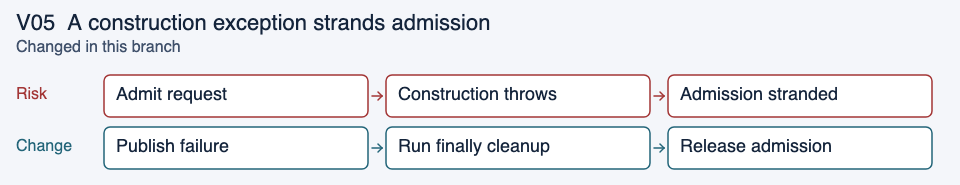

Evidence: [HttpFeedClientShutdownTest](../../vespa-feed-client/src/test/java/ai/vespa/feed/client/impl/HttpFeedClientShutdownTest.java): `constructionFailureDischargesAdmission`.

<a id="v06"></a>

## V06: Abort cannot interrupt a graceful drain

A later abort request could leave the first closer waiting in an unconditional graceful drain. Repeated graceful requests must also not reverse an abort.

Share the lifecycle state and let the drain loop observe escalation. Only the first request starts cleanup.

```java
while (draining.getAsBoolean() && inflight.get() > 0)
    Thread.sleep(10);
```

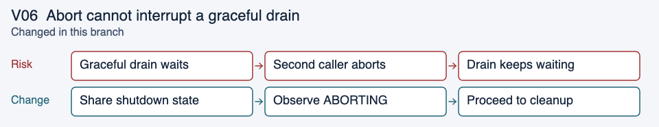

Evidence: [HttpFeedClientShutdownTest](../../vespa-feed-client/src/test/java/ai/vespa/feed/client/impl/HttpFeedClientShutdownTest.java): `abortEscalatesWhileRealStrategyIsDraining`, `repeatedCloseSharesCleanupAndAllowsEscalation`.

<a id="v07"></a>

## V07: A progress thread waits for its own shutdown

A result callback, cleanup owner, dispatcher or result-policy callback can block on shutdown that needs that same thread to continue.

Reject a blocking wait from known progress-owning threads while shutdown is unfinished. closeAsync initiates shutdown without waiting; an independent thread can await the shared handle.

```java
ShutdownHandle handle = client.closeAsync(false);
// On an independent thread:
handle.await();
```

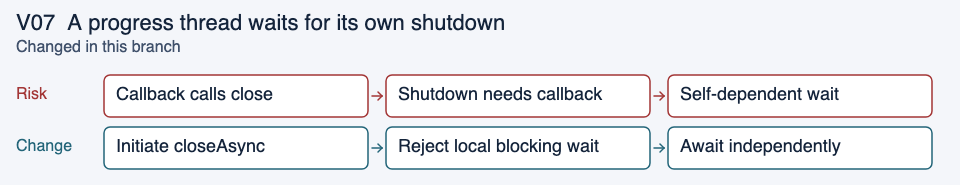

Evidence: [HttpFeedClientShutdownTest](../../vespa-feed-client/src/test/java/ai/vespa/feed/client/impl/HttpFeedClientShutdownTest.java): `callbackWaitIsRejectedWhileShutdownContinues`, `cleanupCannotWaitForItsOwnTermination`, `strategyProgressThreadCannotWaitForShutdown` (both dispatcher and result-policy parameters).

<a id="v08"></a>

## V08: A second destroy returns before cleanup finishes

An atomic started flag prevents duplicate cleanup, but it does not make later callers wait for the first caller’s cleanup result.

Keep one destruction result. Repeated callers join it and observe the same success or failure.

```java
if (destroyed.compareAndSet(false, true)) {
    // Perform cleanup and complete destruction.
}
destruction.join();
```

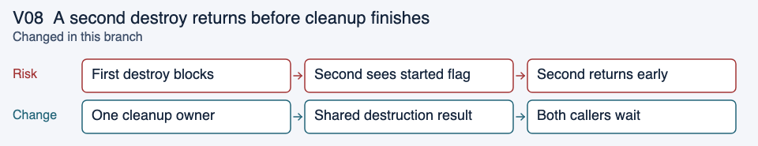

Evidence: [HttpRequestStrategyTest](../../vespa-feed-client/src/test/java/ai/vespa/feed/client/impl/HttpRequestStrategyTest.java): `concurrentDestroyWaitsForTransportCleanup`, `transportCleanupFailureDoesNotLeaveResultWorkerRunning`.

<a id="v09"></a>

## V09: A cleanup failure disappears for later callers

Without a retained outcome, a later observer can miss an earlier cleanup failure.

Publish FAILED with the original cause. Repeated waits report that failure; FAILED does not mean every resource was released.

```java
ShutdownHandle handle = client.closeAsync(true);
handle.await(); // Throws FeedException on cleanup failure.
// handle.snapshot().failure() retains the cause.
```

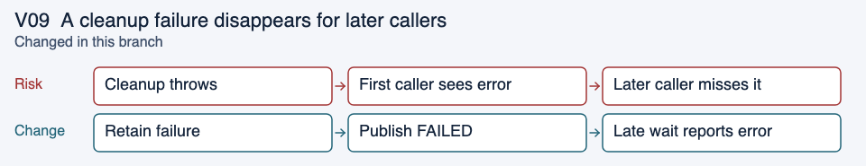

Evidence: [HttpFeedClientShutdownTest](../../vespa-feed-client/src/test/java/ai/vespa/feed/client/impl/HttpFeedClientShutdownTest.java): `cleanupFailureRemainsObservableToLateWaiters`.

<a id="v10"></a>

## V10: Transport close skips worker cleanup when it throws

A transport-close exception could skip shutdown of the result executor or the reset-accounting executor.

Attempt transport close and executor shutdown as separate cleanup stages. Keep the first failure and attach later failures. The injected tests check that the captured workers exit and the original failure remains visible.

```java
try { cluster.close(); }
catch (Throwable t) { failure = retainFailure(failure, t); }
try { resultExecutor.shutdown(); }
catch (Throwable t) { failure = retainFailure(failure, t); }
failure = awaitTermination(resultExecutor, terminationTimeout, "result processing", failure);
```

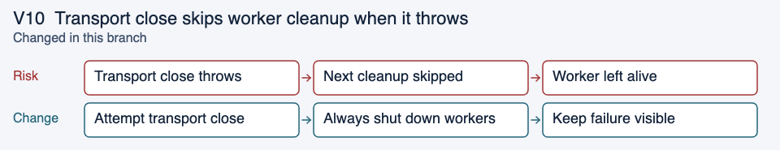

Evidence: [HttpRequestStrategyTest](../../vespa-feed-client/src/test/java/ai/vespa/feed/client/impl/HttpRequestStrategyTest.java): `transportCleanupFailureDoesNotLeaveResultWorkerRunning`, `transportCleanupFailureDoesNotLeaveResetAccountingWorkerRunning`.

<a id="v11"></a>

## V11: Cleanup waits while holding the accounting monitor

Reset-accounting tasks need the same monitor that close previously held while awaiting their executor. That wait could prevent those tasks from finishing.

Release the monitor before waiting for executor termination. Existing reset and shutdown tests exercise the surrounding path; this case still needs a dedicated ordered regression.

```java
// Ownership is claimed under the monitor; transport closes run outside it.
for (Cluster cluster : toClose) {
    try { cluster.close(); }
    catch (Throwable t) { failure = retainFailure(failure, t); }
}
failure = awaitTermination(executor, terminationTimeout, "reset accounting", failure);
```

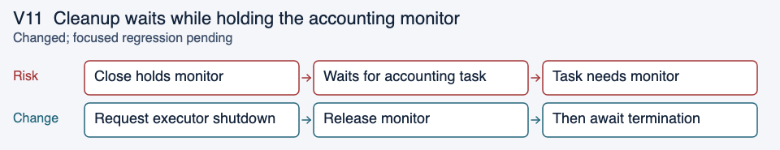

Evidence: [HttpRequestStrategyTest](../../vespa-feed-client/src/test/java/ai/vespa/feed/client/impl/HttpRequestStrategyTest.java): `testResettingCluster`, `testShutdown`. Source-order correction; dedicated regression pending.

<a id="v12"></a>

## V12: Success is reported before dispatcher exit

Closing shared resources does not establish that a dispatcher paused elsewhere has stopped.

Join the dispatcher after shared cleanup on the successful path, avoiding self-join. The test holds the dispatcher, verifies the shutdown wait remains pending, then releases it.

```java
destruction.join();
if (Thread.currentThread() != dispatcher)
    dispatcher.join();
```

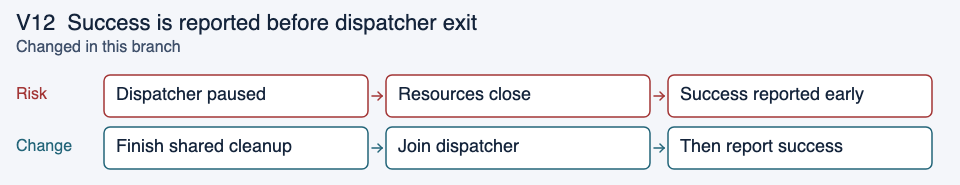

Evidence: [HttpFeedClientShutdownTest](../../vespa-feed-client/src/test/java/ai/vespa/feed/client/impl/HttpFeedClientShutdownTest.java): `successfulTerminationWaitsForDispatcherExit`.

<a id="v13"></a>

## V13: A capacity waiter resumes after abort

An operation registered before abort can be waiting for a slot. When capacity becomes available, it must not start new work after cleanup.

Check the abort flag while waiting and again before acquisition. Discharge the unacquired registration when acquisition fails. The check and increment are still separate operations; broader interleavings remain to be checked.

```java
if (!acquireSlot()) {
    inflightById.remove(documentId, result);
    result.complete();
    return result;
}
```

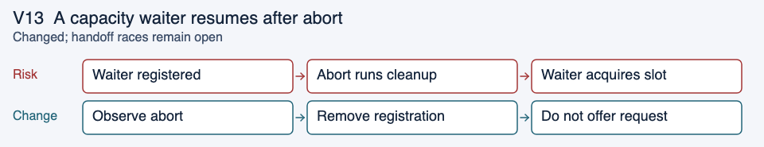

Evidence: [HttpRequestStrategyTest](../../vespa-feed-client/src/test/java/ai/vespa/feed/client/impl/HttpRequestStrategyTest.java): `capacityWaiterCannotAcquireOrOfferAfterAbort`.

<a id="v14"></a>

## V14: The dispatch loop sends queued work after abort

After a held dispatch returns, the inner loop could continue taking requests that were already queued when abort began.

Check the abort flag before polling for the next queued request. The test holds the first dispatch, queues another, aborts, then checks that the queued request is not sent. This is not an atomic guarantee across a concurrent check-and-poll race.

```java
private boolean poll() {
    if (destroyed.get()) return false;
    Runnable task = queue.poll();
    // Existing dispatch path follows.
}
```

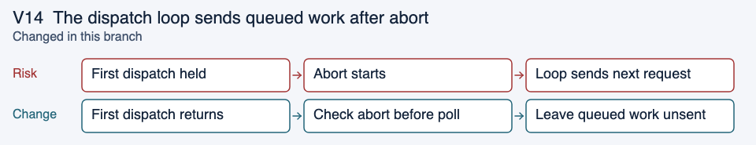

Evidence: [HttpRequestStrategyTest](../../vespa-feed-client/src/test/java/ai/vespa/feed/client/impl/HttpRequestStrategyTest.java): `abortDoesNotDispatchQueuedRequestsAfterBlockedDispatchReturns`.

<a id="v15"></a>

## V15: An observer interferes with shared shutdown

A timeout or interruption should end only that caller’s wait. Observation should not initiate shutdown or cancel another caller’s cleanup.

Expose a read-only shared handle. The blocking close wrapper restores the interrupt flag; independent observers can still await the same shutdown.

```java
ShutdownHandle handle = client.termination();
handle.await(Duration.ofMillis(50));
// Timeout ends this wait, not shared shutdown.
```

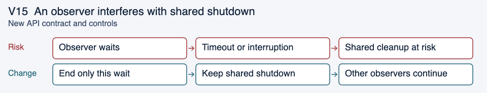

Evidence: [HttpFeedClientShutdownTest](../../vespa-feed-client/src/test/java/ai/vespa/feed/client/impl/HttpFeedClientShutdownTest.java): `observationDoesNotInitiateAndTimeoutDoesNotClose`, `interruptedObserverDoesNotInterruptSharedShutdown`.

<a id="v16"></a>

## V16: A snapshot reports contradictory state

A public snapshot could claim success while retaining outstanding work, or attach a failure to a non-failed phase.

Validate phase, failure and ownership counts at construction. FAILED may retain outstanding work; TERMINATED may not.

```java
if (phase == Phase.TERMINATED && outstandingOperations != 0)
    throw new IllegalArgumentException(
        "Successful termination cannot retain outstanding operations");
```

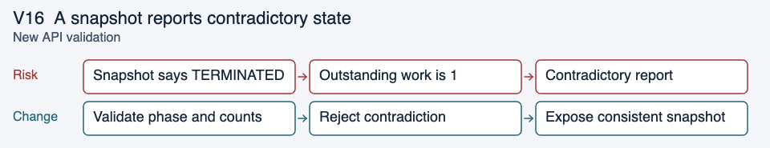

Evidence: [ShutdownHandleTest](../../vespa-feed-client-api/src/test/java/ai/vespa/feed/client/ShutdownHandleTest.java): `snapshotRejectsContradictoryOutcomeAndOwnership`.

<a id="v17"></a>

## V17: Worker startup failure strands shutdown

Admission closed before thread creation and start. A failure there left no worker to publish an outcome, so later callers could wait forever.

Catch creation/start failure and publish FAILED with the original cause. Later callers observe that same failure. No blocking cleanup runs inside closeAsync as a fallback; FAILED explicitly permits resources to remain unreleased. An earlier admitted send may still be constructing when startup fails; a failed snapshot may therefore retain admission and operation counts.

```java
try {
    Thread worker = shutdownThreads.newThread(this::shutdown);
    worker.start();
} catch (Throwable failure) {
    lifecycle.finish(failure);
}
```

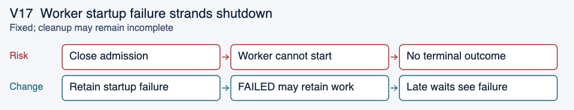

Evidence: [HttpFeedClientShutdownTest](../../vespa-feed-client/src/test/java/ai/vespa/feed/client/impl/HttpFeedClientShutdownTest.java): `workerStartupFailureRemainsObservable`, with creation and start failure parameters; also checks no inline destruction.

<a id="v18"></a>

## V18: Executor timeout is mistaken for success

A held result callback can keep its executor alive after the public future is complete. Previously, an executor timeout only logged a warning and shutdown could report success.

Both result-processing and reset-accounting executor waits now retain timeout or interruption as cleanup failure. Preserve the interrupt flag and any earlier error. A real held result callback exercises the timeout; mock-executor cases cover interruption, error aggregation and successful termination. If the worker exits later, callers still observe the original failed shutdown outcome.

```java
if (!executor.awaitTermination(timeout.toNanos(), TimeUnit.NANOSECONDS))
    return retainFailure(failure, new FeedException(
            "Timed out waiting for " + name + " executor termination"));
```

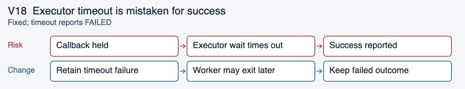

Evidence: [HttpFeedClientShutdownTest](../../vespa-feed-client/src/test/java/ai/vespa/feed/client/impl/HttpFeedClientShutdownTest.java): `executorTimeoutCannotReportSuccessfulTermination`; [HttpRequestStrategyTest](../../vespa-feed-client/src/test/java/ai/vespa/feed/client/impl/HttpRequestStrategyTest.java): `executorTimeoutPreservesEarlierCleanupFailure`, `executorInterruptionIsRetainedAndInterruptFlagRestored`, `completedExecutorDoesNotCreateCleanupFailure`.

<a id="v19"></a>

## V19: Every completion scans the whole backlog

Registration and publication each scanned every outstanding operation under one monitor. Building a backlog therefore added quadratic traversal work.

Remove the affected operation directly. Snapshot and shutdown waits inspect only publication calls that may still be inside inline callbacks. A counting test checks that registration and publication never iterate the outstanding set; this is not a throughput benchmark. The three removal conditions must remain together. A completed or cancelled public future alone does not establish that internal mapping finished; eligible retained entries must remain discoverable in the publication set.

```java
private boolean removeCompleted(Operation operation) {
    if (!operation.registered || !operation.resolved || !operation.result.isDone()) return false;
    operations.remove(operation);
    return true;
}
```

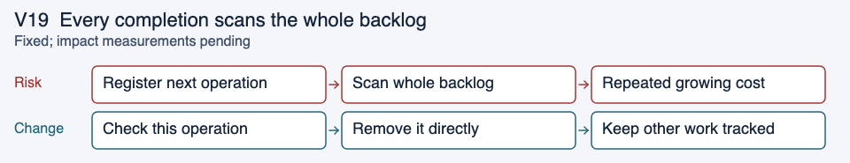

Evidence: [ShutdownLifecycleTest](../../vespa-feed-client/src/test/java/ai/vespa/feed/client/impl/ShutdownLifecycleTest.java): `registrationAndPublicationDoNotScanTheOutstandingBacklog` uses 256 outstanding operations and counts traversal without wall-clock thresholds.

<a id="v20"></a>

## V20: A test checks before cleanup has run

The close caller could enter a wait before the separate cleanup worker ran. Checking destruction at that moment could let a broken implementation pass.

Capture the actual cleanup worker and observe its lifecycle wait while the operation is held. The tests now detect removing the admission wait and removing the mapping wait in separate mutation runs. Both mutations were restored before the final build. The admission mutation establishes an ordering violation before strategy drainage; the later operation wait may still prevent destruction. The mapping mutation checks the distinct wait before graceful destruction.

```java
client.closeAsync(true);
awaitLifecycleWait(cleanupWorker.get(), "awaitAdmissions");
assertFalse(strategy.destroyed.get());
```

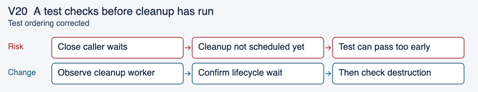

Evidence: [HttpFeedClientShutdownTest](../../vespa-feed-client/src/test/java/ai/vespa/feed/client/impl/HttpFeedClientShutdownTest.java): `gracefulCloseWaitsForAdmittedConstruction`, `responseMappingRemainsOwnedUntilPublicResultIsPublished`; both removed-wait mutations were detected.

<a id="v21"></a>

## V21: Idle reset abandons the old delegate

Reset replaced the delegate and its in-flight counter, but only a later response callback closed the old delegate. When the old count was already zero, no callback remained to release it.

Keep the previous delegate and counter until replacement creation succeeds. Track the retired delegate and schedule the idle check on the existing accounting worker. That worker claims cleanup under the monitor and closes outside it. Active requests retain their old delegate until the final response or shutdown. Same-instance controls cover idle reuse only; arbitrary reuse of old transport identities is not supported. A close attempt is not a guarantee of physical release when close throws.

```java
Cluster previous = delegate;
AtomicLong previousInflight = inflight;
delegate = clusterFactory.create();
inflight = new AtomicLong(0);
retired.remove(delegate);
if (previous != delegate) {
    retired.add(previous);
    executor.execute(() -> retireIfIdle(previous, previousInflight, false));
}
```

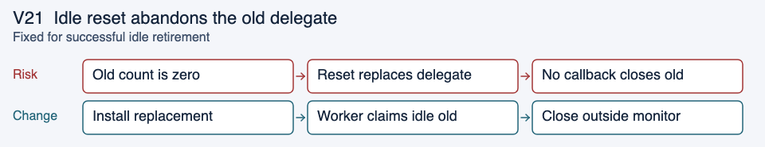

Evidence: [HttpRequestStrategyTest](../../vespa-feed-client/src/test/java/ai/vespa/feed/client/impl/HttpRequestStrategyTest.java): `idleResetClosesRetiredClusterExactlyOnce` (four parameter combinations), `resetFailureStillClosesTheOwnedCluster` (two injected failures), and strengthened `testResettingCluster` active-request controls. Both initial idle-regression cases failed before the change.

<a id="v22"></a>

## V22: Late responses lose retired transport cleanup

Shutdown stopped the accounting executor while an old transport still had a pending response. Its eventual callback was rejected, so the old transport was never closed. A response that never arrived had the same resource problem.

Keep retired transports owned until a worker or shutdown claims their close. Shutdown claims all remaining transports under the monitor, then closes them outside it and waits for already-running retirement. Late responses only decrement accounting: they never stop a transport on its own callback thread. Attempt every claimed close and retain failures for shutdown callers. Reset and dispatch cannot create or use another transport after the close gate.

```java
synchronized (monitor) {
    closed = true;
    toClose = new ArrayList<>(retired);
    retired.clear();
    toClose.add(delegate);
    try { executor.shutdown(); }
    catch (Throwable t) { failure = t; }
}
// Close every claimed transport outside the monitor;
// retain failures, then wait for the accounting worker.
```

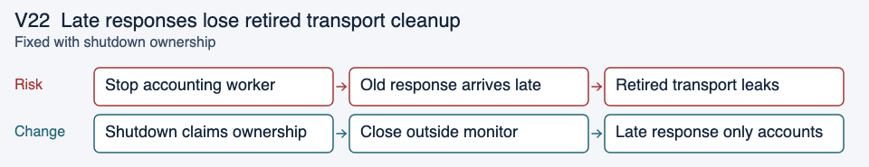

Evidence: `lateRetiredResponseDoesNotLoseCleanup` covers success, exception, completion during close, no response, duplicate completion and injected close failures. `shutdownWaitsForClaimedRetirement` holds an already-claimed close and checks waiting plus combined failures. The exact-source experiment also checks three active generations, two throwing closes and reset/dispatch after shutdown using real file channels.

## What this branch does not finish

| Open item | Why it matters | Next check |
| --- | --- | --- |
| A close throws or never returns | Failure is retained, but an attempt cannot guarantee physical release; a blocked transport close can still stall cleanup | Validate partial release and bounded diagnostics with real transport |
| Retirement fails after a timed-out or interrupted executor wait | A later failure may occur after the shared outcome has already been reported | Preserve the wait failure and investigate separate late-failure diagnostics |
| Atomic registry, capacity and queue handoffs | Abort checks and subsequent actions are separate | Force abort between check and action, including same-ID successors |
| Independent stall diagnostics | Early stalls can occur before any executor wait | Add bounded diagnostics with controlled time and a blocked logging handler |
| Delegate visibility and wider cleanup combinations | Source inspection leaves concurrency and resource questions | Check stats/reset callers, rejection, partial close and multiple failures |

Earlier source experiments reproduced idle-reset and late-callback resource failures. This branch now closes owned retired transports at shutdown and preserves late accounting without running transport cleanup on callback threads. Normal retirement and shutdown close outside the accounting monitor. Tests establish behavior for factories that create fresh transports; idle same-instance controls do not establish arbitrary identity-reuse safety. The full Jetty integration environment is unavailable here, and GitHub Actions is blocked by billing. A Vespa maintainer needs to run these cases with the real transport and check worker, socket and file retention.

Performance measurements remain deferred. The agreed comparison uses distinct-ID and same-ID workloads at low and saturated load, reporting throughput, submission/shutdown latency, allocation and retained resources. A repeatable throughput or p95 submission-latency regression above 5% needs review. No performance acceptance is claimed.

## Review and rerun

Run the affected Maven reactor with the repository’s supported JDK and normal checks:

```sh
mvn -B -Dproject.build.outputTimestamp=2026-11-04T00:00:00Z \
  -pl vespa-feed-client-api,vespa-feed-client,vespa-feed-client-cli -am clean install
```

For individual ordering tests, use the method names beside each case. Keep the baseline failure, changed-version result and environment together. Extend the held-dependency cases with real HTTP delays, connection resets, same-ID chains and combined cleanup failures before treating this as ready for production.

The rendered diagrams accompany this document. Report-generation tooling and planning records are retained separately in the research garden.
